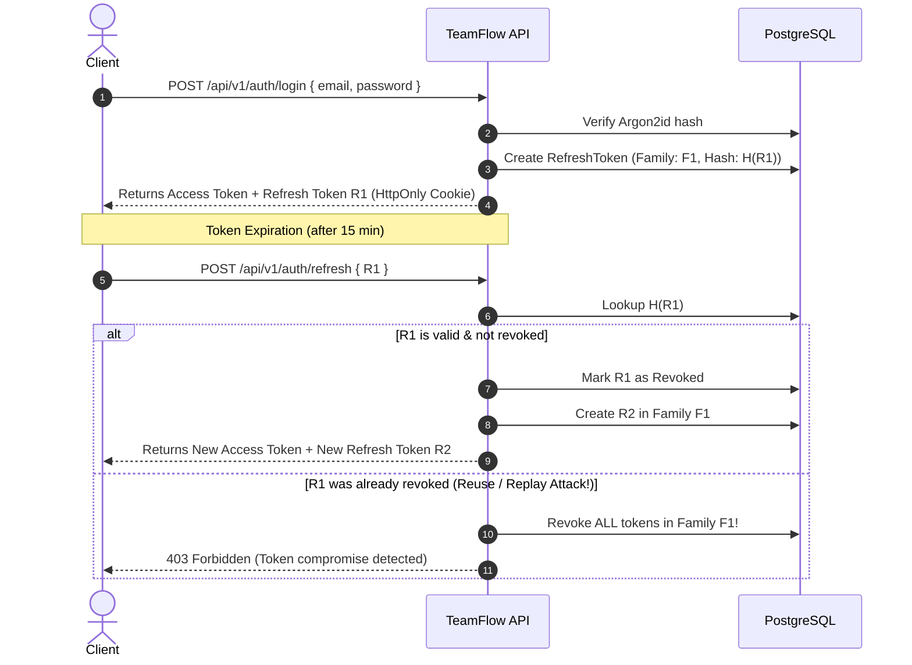

# TeamFlow — Authentication & Security Architecture

## 1. Overview
TeamFlow implements modern, resilient, multi-tiered authentication following OWASP Application Security Verification Standards (ASVS).

---

## 2. Password Hashing (Argon2id)
- **Algorithm**: `Argon2id` (winner of the Password Hashing Competition, resistant to GPU/ASIC and side-channel timing attacks).
- **Parameters**:
  - Memory Cost: 64 MB (`65536` KiB)
  - Time Cost: 3 iterations
  - Parallelism: 4 threads
- Passwords are salted automatically and raw plain-text passwords are never logged or persisted.

---

## 3. JWT Access Tokens
- **Lifespan**: 15 minutes (`ACCESS_TOKEN_EXPIRES_IN=15m`).
- **Algorithm**: HMAC-SHA256.
- **Payload**:
  ```json
  {
    "userId": "uuid-here",
    "email": "user@example.com",
    "role": "USER",
    "sessionId": "session-uuid-here",
    "iat": 1700000000,
    "exp": 1700000900
  }
  ```
- Delivered in response body and accepted via `Authorization: Bearer <token>` or fallback cookie.

---

## 4. Secure Refresh Token Rotation & Reuse Detection

### Flow Diagram



### Key Security Safeguards
1. **Never persist raw tokens**: The database stores only SHA-256 hashes of refresh tokens.
2. **One-Time Use**: Refreshing rotates the token; old tokens are revoked immediately.
3. **Reuse Detection (Token Families)**: If an attacker steals an old refresh token and attempts to refresh, the server recognizes a revoked token was presented and invalidates the entire family, kicking out both attacker and victim to protect the account.
4. **Session Transparency**: Users can view all active sessions (`GET /api/v1/auth/sessions`) with IP addresses, user agents, and revoke individual sessions on demand.

---

## 5. Cookie Security
- `HttpOnly`: Accessible only by the browser engine, preventing JavaScript XSS access.
- `Secure`: Transmitted only over HTTPS in production.
- `SameSite=Strict` in production (prevents Cross-Site Request Forgery).
- Explicit cookie path restricted to `/api/v1/auth`.

---

## 6. Access Control & Authorization (RBAC)
Three distinct, non-overlapping permission layers:

1. **Platform Roles**:
   - `PLATFORM_ADMIN`: System-wide maintenance.
   - `USER`: Standard platform member.

2. **Workspace Roles**:
   - `OWNER`: Full control, billing, ownership transfer, delete workspace.
   - `ADMIN`: Manage projects, invite members, modify roles.
   - `MEMBER`: Create and contribute to projects/tasks.
   - `GUEST`: View and comment on invited tasks.

3. **Project Roles**:
   - `MANAGER`: Configure boards, columns, archive project, manage project members.
   - `MEMBER`: Create, edit, assign, move tasks.
   - `VIEWER`: Read-only access to boards and tasks.

*Important Principle*: Workspace and Project roles are strictly scoped. A Project Manager has no authority over other projects or workspace administration.
