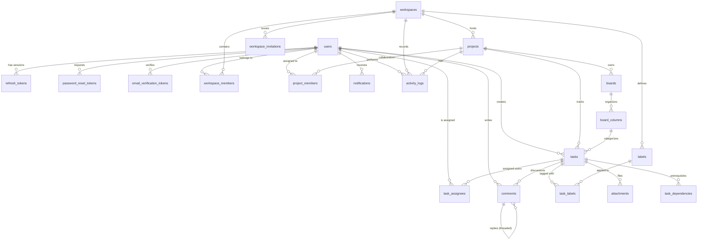

# TeamFlow — Database Design & Schema Documentation

## Database Engine
- **Engine**: PostgreSQL 16+ (Local instance: PostgreSQL 18.4)
- **ORM**: Prisma ORM v6
- **Database Name**: `teamflow_db` (Test Database: `teamflow_test_db`)
- **Key Strategy**: UUID v4 primary keys across all tables

---

## Entity Relationship Diagram (ERD)

---

## Table Schemas & Specifications

### 1. `users`
| Column | Type | Constraints | Description |
|---|---|---|---|
| `id` | UUID | PK, default uuid() | Unique user identifier |
| `name` | VARCHAR(100) | NOT NULL | User full name |
| `email` | VARCHAR(255) | UNIQUE, NOT NULL | Lowercased unique email |
| `passwordHash` | VARCHAR(255) | NOT NULL | Argon2id hash with salt |
| `avatarUrl` | VARCHAR(500) | NULL | Optional profile photo URL |
| `status` | ENUM | ACTIVE, INACTIVE, SUSPENDED | Account status |
| `platformRole` | ENUM | PLATFORM_ADMIN, USER | Platform access tier |
| `emailVerifiedAt` | TIMESTAMP | NULL | Verification timestamp |
| `createdAt` / `updatedAt` | TIMESTAMP | NOT NULL | Audit timestamps |
| `deletedAt` | TIMESTAMP | NULL | Soft-deletion timestamp |

### 2. `refresh_tokens`
| Column | Type | Constraints | Description |
|---|---|---|---|
| `id` | UUID | PK | Session ID |
| `tokenHash` | VARCHAR(255) | UNIQUE | SHA-256 hash of refresh token |
| `userId` | UUID | FK -> `users.id` (CASCADE) | User reference |
| `family` | UUID | INDEX | Token rotation lineage family |
| `isRevoked` | BOOLEAN | default false | Session revocation state |
| `expiresAt` | TIMESTAMP | NOT NULL | 7-day expiration |
| `userAgent` / `ipAddress` | VARCHAR | NULL | Client fingerprint |

### 3. `workspaces`
Multi-tenant root container.
- `ownerId` references `users.id` (RESTRICT deletion).
- `slug` is unique across the platform.
- Workspace data isolation is enforced at the repository and middleware layer.

### 4. `workspace_members`
Composite unique constraint: `(workspaceId, userId)`.
Roles: `OWNER`, `ADMIN`, `MEMBER`, `GUEST`.

### 5. `projects`
- Belongs to `workspaceId` (CASCADE).
- Composite unique constraint: `(workspaceId, key)` ensures project keys (e.g. `TF`, `MOB`) are unique per workspace.
- Roles: `MANAGER`, `MEMBER`, `VIEWER`.

### 6. `boards` & `board_columns`
- Project automatically instantiates default board `Main Board`.
- Board contains columns (`To Do`, `In Progress`, `In Review`, `Completed`).
- Columns use fractional or interval numeric `position` (e.g., 1000, 2000, 3000) for drag-and-drop reordering without full-table rewrites.

### 7. `tasks`
- References `projectId` and `boardColumnId`.
- Status is derived from current `boardColumnId`.
- Column migration constraint ensures tasks can never be moved to a column from an unrelated project.
- `completedAt` timestamp is automatically set when moved to a column with `isCompletedColumn: true`.

### 8. `comments`
- Supports threaded replies via `parentId` FK self-referencing `comments.id` (CASCADE).
- Soft deletion via `deletedAt`.

### 9. `notifications`
- Indexed by `(recipientId, isRead, createdAt)`.

### 10. `activity_logs`
- Append-only audit record of platform events.
- Indexed by `(resourceType, resourceId)` and `(projectId, createdAt)`.

### 11. Additional Production Tables
- `attachments`: File metadata uploaded to tasks.
- `task_dependencies`: Task dependency graph (`BLOCKS`, `REQUIRED_BY`) preventing premature completion.

---

## Indexing Strategy
1. **B-Tree Indexes** on all Foreign Keys (`workspaceId`, `projectId`, `boardId`, `userId`, `taskId`).
2. **Compound Index** `(workspaceId, key)` on `projects`.
3. **Compound Index** `(workspaceId, userId)` on `workspace_members`.
4. **Compound Index** `(projectId, userId)` on `project_members`.
5. **Compound Index** `(taskId, userId)` on `task_assignees`.
6. **Compound Index** `(taskId, labelId)` on `task_labels`.
7. **Sorting & Filtering Indexes**: `(projectId, position)`, `(boardId, position)`, `(recipientId, isRead)`.
